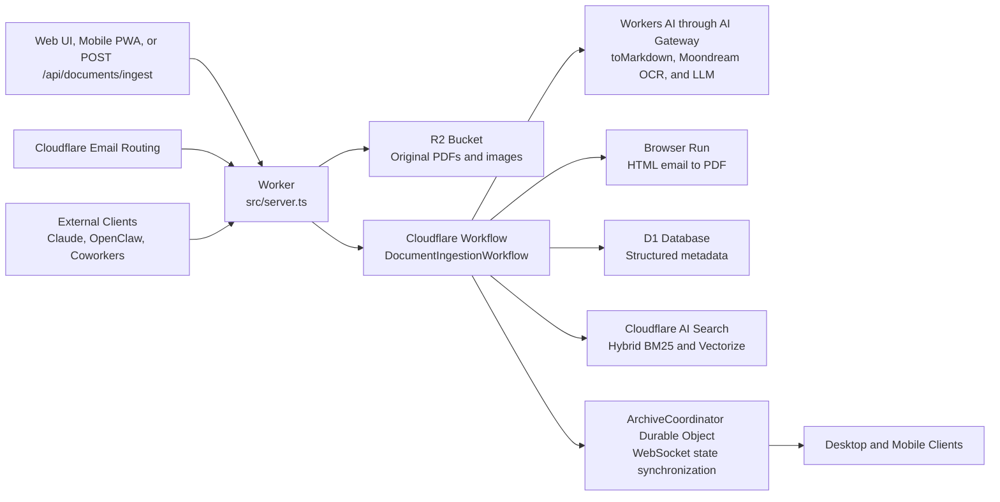
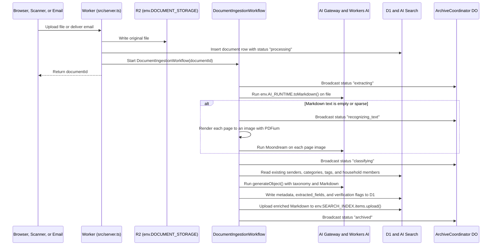

# Schublade vision and architecture

Schublade is a self-hosted document archive that runs on your own Cloudflare account. The name stands for *Schnell und Bequem Lagern aller Dokumente elektronisch*. You upload a PDF, forward an email, or scan a letter from a mobile device, and Schublade classifies and archives the document with no manual tagging.

Paperless-ngx inspired Schublade, and Fayaz Ahmed's [Coworkers](https://github.com/fayazara/coworkers) repository informed its runtime selection. Paperless-ngx relies on a stateful Python server, Redis, PostgreSQL, and manually maintained regular expression rules. Schublade instead uses serverless Cloudflare components and language models to classify and index every file.

## Why automatic archiving replaces an inbox queue

Traditional document management systems treat new uploads as unfiled work. You upload a file, open a holding queue, select a sender, assign a category, and attach tags before the document enters the archive. When that holding queue grows, users stop uploading documents.

Schublade commits every document to the archive as soon as the ingestion workflow finishes. You do not maintain regular expression rules, directory path templates, or physical archive serial numbers.

Automated extraction can still create duplicate sender records or fail to read a degraded total on a thermal receipt. To prevent taxonomy drift without blocking ingestion, Schublade archives the document immediately and sets a verification status only in three situations:

1. **The model creates a new sender, category, or tag.** The extraction prompt includes your existing senders, categories, and tags so the model reuses established records first. When a document arrives from an unrecorded organization such as `Allianz SE`, Schublade creates the sender record and archives the document. It also lists the record in the **Pending verification** view. With one action, you can confirm the new sender, rename it, or merge it into an existing sender record.
2. **A required field is illegible.** If a photographed receipt has an unreadable issue date or total amount, Schublade records the missing field so you can supply it later.
3. **An email attachment is non-archival boilerplate.** Commercial emails frequently attach a signature image or a general terms PDF alongside the primary invoice. Schublade marks the secondary file so you can delete it with one action.

If you do not open the **Pending verification** view for a month, every ingested document remains indexed and searchable in your archive.

## What Schublade extracts and what it omits from Paperless-ngx

Paperless-ngx includes directory path templates for local file systems and Archive Serial Numbers for physical ring binders. Because Schublade stores immutable files in Cloudflare R2 and queries structured metadata in D1, relational filters replace file system directories.

For every document, Schublade records seven primary attributes and a set of category-specific fields:

- **Title.** The model generates a normalized title such as `Vodafone Kabel Deutschland Invoice October 2026`.
- **Document date.** The model extracts the issue date printed on the document rather than the ingestion timestamp.
- **Sender.** The individual, corporation, or authority that issued or received the document, such as `Vodafone`, `Finanzamt`, or `Allianz`.
- **Person.** The household member the document concerns, or `household` for shared documents such as a joint rental contract. See [How a household shares one archive](#how-a-household-shares-one-archive).
- **Category.** A single primary classification such as `Invoice`, `Receipt`, `Contract`, `Tax Notice`, `Bank Statement`, `Insurance`, `Medical`, or `Official Identification`.
- **Tags.** Cross-cutting labels such as `tax-2026`, `apartment`, `vehicle`, or `reimbursable`.
- **Summary.** Two declarative sentences that state what the document is and what transaction or obligation it records.

Based on the assigned category, the same extraction call populates typed key-value rows in the `extracted_fields` table. For an `Invoice` or `Receipt`, the model extracts `amount`, `currency`, `due_date`, `iban`, and `invoice_number`. For a `Contract` or `Insurance` policy, the model extracts `policy_number`, `renewal_date`, and `cancellation_period`.

Schublade omits three features by design:

- **No built-in conversational interface.** Schublade is a document archive and retrieval system, not a chat application. You search and inspect documents in the web interface. When you require conversational analysis, you connect external clients such as Claude, OpenClaw, or Coworkers through the Model Context Protocol endpoint at `/mcp`.
- **No file system path templates or physical binder numbers.** R2 stores immutable originals keyed by document identifier, and D1 indexes their relational attributes.
- **No outbound mail transmission.** Schublade receives electronic mail solely to ingest documents, and does not transmit mail.

## How the Cloudflare components fit together

One Cloudflare Worker runs the entire system. It serves the TanStack Start web application, the `/api/documents/ingest` endpoint, the `/mcp` server, the inbound mail handler, the `ArchiveCoordinator` Durable Object, and `DocumentIngestionWorkflow`.



### Why D1 and Cloudflare AI Search divide storage and indexing

A document archive requires two distinct retrieval mechanisms. You filter by exact relational facets such as sender, category, tag, date range, or invoice amount, and you search across the full text of thousands of pages.

Maintaining SQLite FTS5 virtual tables and synchronization triggers inside D1 would duplicate capabilities that Cloudflare AI Search already provides. Cloudflare AI Search maintains both a BM25 keyword index and a Vectorize embedding index, and merges their rankings using Reciprocal Rank Fusion.

To avoid the 15-minute to 24-hour latency of scheduled R2 bucket synchronization jobs in AI Search, Schublade separates binary object storage from search indexing:

1. **R2 stores the unmodified original file.** When a PDF or image arrives, the Worker writes the binary payload to `env.DOCUMENT_STORAGE` under `documents/<documentId>/original.<fileExtension>`.
2. **AI Search indexes the enriched Markdown immediately.** After the ingestion workflow extracts text, performs optical character recognition, and classifies metadata, the workflow calls `env.SEARCH_INDEX.items.upload()` with the item name `<documentId>.md`. That call writes the combined title, sender, summary, tags, and full Markdown text into AI Search's managed storage. AI Search indexes the document without scheduling delay.
3. **D1 stores the relational records.** D1 holds nine standard SQLite tables managed with Drizzle ORM, covering `documents`, `senders`, `categories`, `tags`, `document_tags`, `extracted_fields`, `household_members`, `api_tokens`, and `authorization_grants`.

When you filter the document table by category or sort invoices by amount, the Worker queries D1 in a few milliseconds. When you submit a text query, the Worker calls `env.SEARCH_INDEX.search()` in hybrid mode. That call returns the matching item names and highlighted text passages, which the Worker joins with D1 metadata. Even if a query is in English and the invoice is in German, the multilingual embedding model matches the semantic content while BM25 matches exact invoice numbers and IBAN strings.

### Which filters AI Search applies and which D1 applies

AI Search accepts at most five custom metadata fields per instance. Each field holds one value, so a field cannot hold a list of tags. AI Search also fills the reserved `filename`, `folder`, and `timestamp` fields automatically.

A filter belongs in AI Search when you combine it with a text query. AI Search ranks the top results inside the filtered set. A filter that D1 applies afterwards can only remove results from those top results. If a search for `insurance` returns twenty passages and three belong to one household member, a D1 filter for that member shows three results even when the member has twelve insurance documents.

Schublade assigns the fields as follows:

| Field | Kind | Content |
| --- | --- | --- |
| `filename` | Reserved | `<documentId>.md`, which joins a search result to its D1 row |
| `person` | Custom text | Household member identifier, or `household` |
| `sender` | Custom text | Sender identifier |
| `category` | Custom text | Category identifier |
| `document_date` | Custom datetime | Issue date of the document |
| Unassigned | Custom | Reserved for a later requirement |

D1 applies tag filters, amount ranges, and the tag predicates of an `AuthorizationScope` to the candidates that AI Search returns. The search operation already joins every candidate with D1, so these predicates add no query. When a D1 predicate is active, the search operation requests a larger candidate set from AI Search so that the result page still fills.

AI Search offers no operation that updates an indexed item. When you rename or merge a sender, category, or person, Schublade uploads each affected item again under the same name.

### How the ingestion workflow processes a file

Uploading twenty PDFs simultaneously must not block an HTTP request or lose state if an inference request times out. Each uploaded file starts a durable `DocumentIngestionWorkflow` instance on Cloudflare Workflows. Every step persists its output before the next step begins, and retries independently on transient errors.



The text extraction and classification pipeline executes in three stages:

1. **Markdown conversion.** The workflow calls `env.AI_RUNTIME.toMarkdown()` on the file bytes. For digital PDFs, HTML files, and PDFs generated with on-device optical character recognition in applications such as QuickScan, `toMarkdown()` extracts the text structure at no inference cost.
2. **Conditional optical character recognition fallback.** Scanned PDFs without a text layer yield fewer than 40 characters per page from `toMarkdown()`, and camera uploads arrive as raster images. A Worker has no canvas, so the workflow renders each scanned page to a grayscale PNG at 150 dots per inch with PDFium compiled to WebAssembly (`@embedpdf/pdfium`). The workflow then sends each page image to `@cf/moondream/moondream3.1-9B-A2B` in a separate call that asks for a verbatim transcription. Camera uploads go to the model without rendering. Each page runs as its own workflow step, so a failed page retries without repeating the others.
3. **Structured classification.** The workflow calls `generateObject()` from the Vercel AI SDK with `workers-ai-provider` and a strict Zod schema. The prompt includes the extracted Markdown, any email header fields, your current list of senders, categories, and tags, and the household members from D1.

Every inference request runs on a Workers AI model through AI Gateway, which logs, caches, and rate-limits each request. Schublade sends no document to a third-party model provider and requires no provider API key.

### How inbound email and scanner uploads operate

Schublade accepts documents through three interfaces:

- **Web and mobile application uploads.** You drag files into the browser window or select the document capture control on a mobile device.
- **Inbound mail via Cloudflare Email Routing.** The Worker exports an `email(message, env)` handler and parses incoming MIME messages with `postal-mime`. To reject unsolicited mail, the handler verifies that `message.from` appears on your sender allowlist or that `message.to` matches your designated ingestion address, such as `docs+<token>@schublade.org`. When the message contains PDF or image attachments, the Worker discards inline signature graphics smaller than 15 KB. It starts a `DocumentIngestionWorkflow` for each valid attachment and supplies the email subject, sender address, and plain-text body as classification context. Some forwarded receipts, such as Apple App Store or airline confirmations, contain no file attachments. For those body-only messages, the workflow renders the HTML body into an archival PDF using Cloudflare Browser Run on `env.BROWSER_RENDERER` and archives that PDF.
- **Token-authenticated `POST /api/documents/ingest`.** Automated callers cannot complete an interactive browser login on Cloudflare Access. The `/api/documents/ingest` route is listed on the Cloudflare Access bypass policy and validates an `Authorization: Bearer <token>` header against SHA-256 token digests stored in D1. You can connect iOS applications such as QuickScan through a two-step Apple Shortcut, transmit scans from network document scanners, or upload files from a command-line script.

### Why one Durable Object coordinates client state

D1 and Workflows manage persistence and background execution, so Schublade requires only one Durable Object class for client synchronization. That class is `ArchiveCoordinator`, built on Cloudflare's `agents` SDK.

When you open Schublade on a desktop or mobile browser, the client establishes a WebSocket connection to `ArchiveCoordinator` using `useAgent`. As `DocumentIngestionWorkflow` transitions a document through `extracting`, `recognizing_text`, `classifying`, and `archived`, the workflow notifies `ArchiveCoordinator` over Durable Object RPC. `ArchiveCoordinator` then broadcasts the state transition to every connected client. Newly uploaded documents transition from a processing indicator into their final archive row without page reloads or HTTP polling.

## One access control layer for the UI, API tokens, and MCP

Every operation in Schublade resides in `src/operations/` as a typed procedure with a Zod input schema, a required permission level, and a central authorization guard. The TanStack Start server functions, the `/api/documents/ingest` endpoint, and the `/mcp` server all invoke `executeOperation(caller, input)`.

```ts
type PermissionLevel = "read" | "ingest" | "modify" | "administer"

interface AuthorizationScope {
	level: PermissionLevel
	allowedCategories?: string[]
	allowedTags?: string[]
	deniedTags?: string[]
	allowedSenders?: string[]
}
```

The four permission levels define strict operational boundaries:

- **`read`** permits listing documents, reading metadata and extracted fields, executing hybrid searches, and downloading original files or Markdown text.
- **`ingest`** adds uploading new documents through `/api/documents/ingest` or `/mcp`.
- **`modify`** adds updating document titles, senders, categories, tags, and structured fields, and resolving verification entries.
- **`administer`** adds deleting documents, merging sender or tag records, configuring inference models, and issuing API tokens or OAuth grants.

Because `AuthorizationScope` is enforced by the central guard from the outset, Schublade supports both coarse-grained tokens and fine-grained client restrictions without modifying individual operation handlers. You can connect Claude Code, OpenClaw, or Coworkers to `/mcp` using `@cloudflare/workers-oauth-provider`. Each grant can authorize full `read` access or restrict the external client to `allowedCategories: ["Invoice", "Tax Notice"]` and `deniedTags: ["medical", "private"]`. The authorization guard adds category and sender predicates to the AI Search filter and adds every predicate, including the tag predicates, to the D1 query that joins the search candidates. A passage from a denied document never reaches the caller.

## How a household shares one archive

One Schublade deployment serves one household. The household has one member or several. Cloudflare Access decides who can sign in, through the email allowlist that `scripts/provision_environment.ts` configures. The household is trusted, so every member who signs in sees every document. Schublade does not record which member is signed in.

The `household_members` table lists the people that documents concern. A member does not need to sign in, so a child with medical records is a member too. Each member has a display name and the spellings of their name as printed on letters, such as `Mira Wiśniewska` and `M. Wisniewska`.

The classifier assigns each document to one member or to `household`. The extraction prompt lists the members with their name spellings, and the Zod output schema restricts the person field to the known member identifiers and `household`, so the model cannot invent a member. A letter addressed to one member gets that member. A document with no personal addressee, or with several members as addressees, gets `household`. You correct a wrong assignment with one edit, and a person assignment never creates a **Pending verification** entry.

The navigation pane shows a person filter with **Everyone** selected by default, one entry per member, and **Household**. When the household has one member, the filter is hidden.

## Desktop and mobile interface design

Schublade uses **TanStack Start**, **React 19**, **Cloudflare Kumo** from `@cloudflare/kumo`, **Tailwind CSS v4**, and **Phosphor Icons** from `@phosphor-icons/react`, which Kumo requires as a peer dependency.

On desktop viewports, the interface presents a three-pane layout built with `react-resizable-panels`:

1. **Left navigation pane.** Contains the **All documents** and **Pending verification** views, the person filter, **Categories**, pinned **Tags**, and **Settings** for household members, Workers AI models, ingestion tokens, email routing, and authorized MCP clients.
2. **Center search and document table.** Opens with a unified search input activated by `/` or `Cmd+K`. Facet filter controls for person, sender, category, tag, date range, and amount sit directly below the search input. Beneath the filter controls sits a tabular document list. Each row displays the document date, sender, title, person, category indicator, tags, and primary extracted value such as `124.50 EUR`. Uploading files displays active workflow progress indicators at the bottom of the pane.
3. **Right inspection pane.** Selecting a document opens the inspection pane beside the table without resetting your scroll position or search query. The upper section displays editable metadata fields, extracted key-value attributes, and any pending verification prompt. The lower section renders the original PDF or image from R2, with a selector to view the extracted Markdown text.

Mobile usability is a core requirement. Below the `md` viewport breakpoint, Schublade switches to a responsive layout using `useMobileViewport()` and Base UI `Drawer` panels. It also includes a Web App Manifest so you can install the interface on a mobile home screen:

- **Single-column navigation and bottom drawers.** The search input and document list occupy the full viewport width with safe-area bottom padding. Selecting a document opens the document viewer and metadata inspector in a `Drawer` panel, and navigation filters open in a secondary slide-over panel.
- **Bottom action bar.** A fixed bottom bar on mobile viewports provides direct navigation to search and the **Pending verification** queue. Its primary **Upload document** control invokes the device camera, photo library, or system file selector.
- **Touch-sized verification controls.** Confirming a new sender record or supplying a missing field on a mobile viewport uses full-width action buttons that dismiss the verification entry upon completion.

## Self-hosting and deployment model

Schublade is designed for an individual or a household sharing one archive on a dedicated Cloudflare account. It uses the `cf` command-line interface and a typed `cloudflare.config.ts` specification rather than `wrangler.jsonc`. The `cloudflare.config.ts` format is in open beta, so the repository pins the exact `cf` version.

Schublade maintains no internal password table. Executing `pnpm run provision` from the terminal runs `scripts/provision_environment.ts`, which provisions the required Cloudflare resources in four steps:

1. Creates the D1 database, the R2 bucket, the AI Search instance with its four custom metadata fields, and the AI Gateway, applies the Drizzle SQL schema migrations, and records the household members.
2. Deploys the Worker in a locked state so the public hostname rejects all requests until authentication is configured.
3. Configures a **Cloudflare Access** application on Cloudflare Zero Trust, which is free for up to 50 users. The script sets an email allowlist for authorized users and adds a bypass rule for `/api/documents/ingest` and `/mcp`. Those two endpoints validate their own bearer and OAuth tokens.
4. Redeploys the Worker with the `ACCESS_TEAM_DOMAIN` and `ACCESS_AUD` parameters written to a git-ignored `schublade.deploy.json` configuration file.

Every browser request to the Worker must carry a valid Cloudflare Access JSON Web Token. The Worker verifies that cryptographic signature before executing any server function or establishing an `ArchiveCoordinator` WebSocket connection. When `ACCESS_TEAM_DOMAIN` or `ACCESS_AUD` is absent, the Worker rejects every browser request rather than admitting it. Per-version preview hostnames are disabled, because the Access application does not cover them.

### Official domain and staging environment

The `schublade.org` domain is registered and active on Cloudflare. It serves two roles for the project:

- **Public landing page and documentation at `schublade.org`.** Introduces the project, explains the architecture, and provides deployment instructions for self-hosting.
- **Staging and development deployment at `staging.schublade.org`.** Configured through `--mode staging` in `cloudflare.config.ts`, this environment runs the active development build behind Cloudflare Access and receives test email ingestion traffic through `schublade.org` Email Routing rules.

