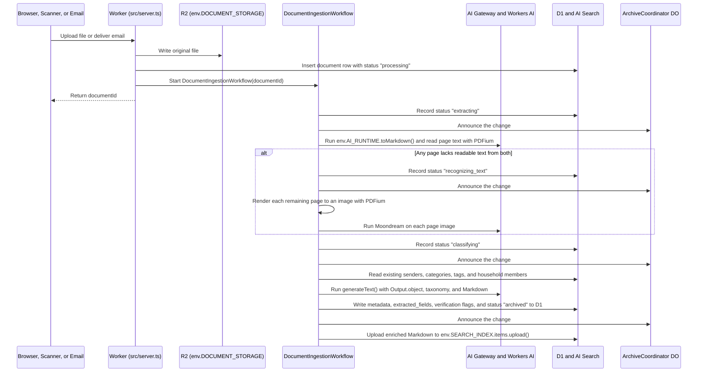

# Schublade vision and architecture

Schublade is a self-hosted document archive that runs on your own Cloudflare account. The name stands for *Schnell und Bequem Lagern aller Dokumente elektronisch*. You upload a PDF, forward an email, or scan a letter from a mobile device, and Schublade classifies and archives the document with no manual tagging.

Paperless-ngx inspired Schublade, and Fayaz Ahmed's [Coworkers](https://github.com/fayazara/coworkers) repository informed its runtime selection. Paperless-ngx relies on a stateful Python server, Redis, PostgreSQL, and manually maintained regular expression rules. Schublade instead uses serverless Cloudflare components and language models to classify and index every file.

Phases 0 to 5 and an interface revision after Phase 4 are built. The `/mcp` server in Phase 6, and both HTML email rendering on Browser Run and the installable mobile layout in Phase 7, are planned. Each section that describes a planned part says so. See [`IMPLEMENTATION_PLAN.md`](IMPLEMENTATION_PLAN.md) for the build order.

## Why automatic archiving replaces an inbox queue

Traditional document management systems treat new uploads as unfiled work. You upload a file, open a holding queue, select a sender, assign a category, and attach tags before the document enters the archive. When that holding queue grows, users stop uploading documents.

Schublade commits every document to the archive as soon as the ingestion workflow finishes. You do not maintain regular expression rules, directory path templates, or physical archive serial numbers.

Automated extraction can still create duplicate sender records or fail to read a degraded total on a thermal receipt. To prevent taxonomy drift without blocking ingestion, Schublade archives the document immediately and sets a verification status only in three situations:

1. **The model creates a new sender, category, or tag.** The extraction prompt includes your existing senders, categories, and tags so the model reuses established records first. Senders, categories, and tags have a confirmation state in `confirmed_at`. Standard categories, confirmed records, and records that you create or name in an edit are confirmed, while records that the classifier creates start unconfirmed. When a document arrives from an unrecorded organization such as `Allianz SE`, Schublade creates an unconfirmed sender record and archives the document. The **Pending verification** view lists each unconfirmed record as one `new_taxonomy_record` entry with every document that refers to it. You can confirm the record, rename it, merge it into another record, or delete an unused, unconfirmed record. A rename onto an existing name proposes a merge. A merge moves every document and tag link in one D1 batch and deletes the source record. If the source record no longer exists, the merge does nothing. When a merge moves documents into another category, Schublade re-checks their required fields.
2. **A required field is illegible.** If a photographed receipt has an unreadable issue date or total amount, Schublade marks the document with `illegible_required_field`. The **Pending verification** view lists the document with its missing fields so you can supply them.
3. **An email attachment is non-archival boilerplate.** Commercial emails frequently attach a signature image or a general terms PDF alongside the primary invoice. The classifier marks boilerplate such as general terms, privacy notices, and advertising with `non_archival_attachment` so you can delete the document or keep it. Deleting a document removes its stored files in R2, its row, tag links, and extracted fields in D1, and its search item in AI Search.

The `documents` table stores at most one of the two document reasons, `non_archival_attachment` or `illegible_required_field`. Because a non-archival file is meant to be deleted, `non_archival_attachment` takes precedence over `illegible_required_field`. Schublade derives `new_taxonomy_record` from unconfirmed records instead of storing it per document, so confirming one record resolves all its documents. Both stored document reasons take precedence over `new_taxonomy_record`. Every destructive action and every merge asks for confirmation in a dialog that states what will happen, such as how many documents move. If you do not open the **Pending verification** view for a month, every ingested document remains indexed and searchable in your archive. A document that fails processing is not archived, but it also appears in the **Pending verification** view with its `failure_reason`, so you can retry or delete it.

## What Schublade extracts and what it omits from Paperless-ngx

Paperless-ngx includes directory path templates for local file systems and Archive Serial Numbers for physical ring binders. Because Schublade stores immutable files in Cloudflare R2 and queries structured metadata in D1, relational filters replace file system directories.

For every document, Schublade records seven primary attributes and a set of category-specific fields:

- **Title.** The model generates a normalized title such as `Vodafone Kabel Deutschland Invoice October 2026`.
- **Document date.** The model extracts the issue date printed on the document rather than the ingestion timestamp.
- **Sender.** The individual, corporation, or authority that issued or received the document, such as `Vodafone`, `Finanzamt`, or `Allianz`.
- **Person.** The household member the document concerns, or `household` for shared documents such as a joint rental contract. See [How a household shares one archive](#how-a-household-shares-one-archive).
- **Category.** A single primary classification such as `Invoice`, `Receipt`, `Contract`, `Tax Notice`, `Bank Statement`, `Insurance`, `Medical`, or `Official Identification`.
- **Tags.** Cross-cutting labels such as `tax-2026`, `apartment`, `vehicle`, or `reimbursable`.
- **Summary.** Two declarative sentences that state what the document is and what transaction or obligation it records.

Based on the assigned category, the same extraction call populates typed key-value rows in the `extracted_fields` table. For an `Invoice` or `Receipt`, the model extracts `amount`, `currency`, `due_date`, `iban`, and `invoice_number`. For a `Contract` or `Insurance` policy, the model extracts `policy_number`, `renewal_date`, and `cancellation_period`.

Schublade omits three features by design:

- **No built-in conversational interface.** Schublade is a document archive and retrieval system, not a chat application. You search and inspect documents in the web interface. When you require conversational analysis, you connect external clients such as Claude, OpenClaw, or Coworkers through the Model Context Protocol endpoint at `/mcp`.
- **No file system path templates or physical binder numbers.** R2 stores immutable originals keyed by document identifier, and D1 indexes their relational attributes.
- **No outbound mail transmission.** Schublade receives electronic mail solely to ingest documents, and does not transmit mail.

## How the Cloudflare components fit together

One Cloudflare Worker runs the entire system. It serves the TanStack Start web application, the `/api/documents/ingest` endpoint, the inbound mail handler, `DocumentIngestionWorkflow`, and the `ArchiveCoordinator` Durable Object. The `/mcp` server is planned for the same Worker.


### Why D1 and Cloudflare AI Search divide storage and indexing

A document archive requires two distinct retrieval mechanisms. You filter by exact relational facets such as sender, category, tag, date range, or invoice amount, and you search across the full text of thousands of pages.

Maintaining SQLite FTS5 virtual tables and synchronization triggers inside D1 would duplicate capabilities that Cloudflare AI Search already provides. Cloudflare AI Search maintains both a BM25 keyword index and a Vectorize embedding index, and merges their rankings using Reciprocal Rank Fusion.

To avoid the 15-minute to 24-hour latency of scheduled R2 bucket synchronization jobs in AI Search, Schublade separates binary object storage from search indexing:

1. **R2 stores the unmodified original file.** When a PDF or image arrives, the Worker writes the binary payload to `env.DOCUMENT_STORAGE` under `documents/<documentId>/original.<fileExtension>`.
2. **AI Search indexes the enriched Markdown immediately.** After the ingestion workflow extracts text, performs optical character recognition, and classifies metadata, the workflow calls `env.SEARCH_INDEX.items.upload()` with the item name `<documentId>.md`. That call writes the title, sender, tags, summary, and full Markdown text into AI Search's managed storage. AI Search indexes the document without scheduling delay.
3. **D1 stores the relational records.** D1 holds nine standard SQLite tables managed with Drizzle ORM, covering `documents`, `senders`, `categories`, `tags`, `document_tags`, `extracted_fields`, `household_members`, `api_tokens`, and `authorization_grants`.

When you filter the document table by category or sort invoices by amount without a text query, the Worker queries D1 in a few milliseconds. When you submit a text query, the Worker calls `env.SEARCH_INDEX.search()` in hybrid mode with the similarity cache disabled so newly indexed documents appear. That call requests the maximum of 50 chunks, groups those chunks by document, and joins each document's best passage with D1 metadata. Even if a query is in English and the invoice is in German, the multilingual embedding model matches the semantic content while BM25 matches exact invoice numbers and IBAN strings.

### Which filters AI Search applies and which D1 applies

AI Search accepts at most five custom metadata fields per instance. Each field holds one value, so a field cannot hold a list of tags. AI Search also fills the reserved `filename`, `folder`, and `timestamp` fields automatically.

A filter belongs in AI Search when you combine it with a text query. AI Search ranks the top results inside the filtered set. A filter that D1 applies afterwards can only remove results from those top results. If a search for `insurance` returns twenty passages and three belong to one household member, a D1 filter for that member shows three results even when the member has twelve insurance documents.

Schublade assigns the fields as follows:

| Field | Kind | Content |
| --- | --- | --- |
| `filename` | Reserved | `<documentId>.md`, which joins a search result to its D1 row |
| `person` | Custom text | Household member identifier, or `household` |
| `sender` | Custom text | Sender identifier |
| `category` | Custom text | Category identifier |
| `document_date` | Custom datetime | Issue date of the document as an ISO 8601 datetime such as `2026-09-22T00:00:00Z`, because Unix seconds do not filter |
| Unassigned | Custom | Reserved for a later requirement |

A text query passes the person, sender, category, and date range filters to AI Search and always requests the maximum of 50 chunks. D1 then reapplies every filter and applies the tag filters and amount ranges to the grouped documents. The predicates of an `AuthorizationScope` exist only as a type today. Once Phase 6 adds scoped OAuth grants for `/mcp`, D1 will also apply those predicates. The search operation already joins every candidate with D1, so these checks add no query, and a stale index item can only drop a result, never show a wrong one. Tag and amount filters only see documents among the top 50 chunks.

Uploading under an existing item name replaces the item in AI Search, so the index step is safe to retry. Each document records the revision that AI Search last indexed in `indexed_at`. A single-document edit re-uploads its search item in the same request, while merges and renames mark the affected documents stale. If a document changes while its item uploads, Schublade does not count the upload as current, so the backfill uploads the document again.

A Cron Trigger on the schedule `*/15 * * * *` and `POST /api/search_index` both run a backfill for archived documents that are missing, failed, or stale in AI Search. The backfill pages through the index until an empty page and stops after 100 pages, or 5,000 items. An index above 5,000 items makes the backfill fail by design. Each call uploads at most 100 documents and reports `failedDocuments` with a reason for each document instead of stopping.

### How the ingestion workflow processes a file

Uploading twenty PDFs simultaneously must not block an HTTP request or lose state if an inference request times out. Each uploaded file starts a durable `DocumentIngestionWorkflow` instance on Cloudflare Workflows. Every step persists its output before the next step begins, and retries independently on transient errors.



An announcement holds no status, so every browser reads the new status from D1. [Why one Durable Object coordinates client state](#why-one-durable-object-coordinates-client-state) explains the reason.

The text extraction and classification pipeline executes in three stages:

1. **Per-page text extraction.** For a PDF, the workflow calls `env.AI_RUNTIME.toMarkdown()` and reads each page's text layer with PDFium compiled to WebAssembly from `@embedpdf/pdfium`. For each page, `selectPageTextSources` chooses the first source that yields readable text. First, it keeps the page's `toMarkdown()` section when that section has at least 40 letters or digits, which preserves tables as Markdown at no inference cost. `toMarkdown()` returns empty page sections for tagged PDFs whose structure tree it cannot follow. On an Apache FOP train ticket, `toMarkdown()` returned only the metadata block while the text layer held 2,370 letters and digits. Second, when the `toMarkdown()` section is too short, the workflow checks PDFium's text extraction for that page. It uses that text when the page has at least 40 letters or digits and fewer than one replacement character per ten of them.
2. **Conditional optical character recognition fallback.** Third, a PDF page that fails both text checks, or a camera upload that arrives as a raster image, goes to `@cf/moondream/moondream3.1-9B-A2B`. At most 50 pages per document may use this recognition path. A Worker has no canvas, so the workflow renders each remaining PDF page to a grayscale PNG at 150 dots per inch with PDFium. The workflow then sends each page image to `@cf/moondream/moondream3.1-9B-A2B` in a separate call that asks for a verbatim transcription. The Moondream service returns 3-byte UTF-8 characters such as the euro sign as `U+FFFD`, while 2-byte characters such as `ä`, `ß`, and `ś` survive. Schublade restores `€` only directly beside a two-decimal amount and tells the classifier that any remaining `U+FFFD` marks an unreadable character. Camera uploads go to the model without rendering. Each page runs as its own workflow step, so a failed page retries without repeating the others.
3. **Structured classification.** The workflow calls `generateText()` with `Output.object` from the Vercel AI SDK, `workers-ai-provider`, and a strict Zod schema. The default classification model is `@cf/deepseek-ai/deepseek-v4.1-flash-1017`, chosen by the extraction evaluation on the synthetic test documents. You can override it per deployment with `classificationModel` in `schublade.deploy.json`. The prompt includes the extracted Markdown, any email header fields, your current list of senders, categories, and tags, and the household members from D1.

Every inference request runs on a Workers AI model through AI Gateway, which logs, caches, and rate-limits each request. Schublade sends no document to a third-party model provider and requires no provider API key.

### How inbound email and scanner uploads operate

Schublade accepts documents through three interfaces:

- **Web and mobile application uploads.** You drag files into the browser window or select the document capture control on a mobile device.
- **Inbound mail via Cloudflare Email Routing.** The Worker exports an `email(message, env)` handler and parses incoming MIME messages with `postal-mime`. Before reading the message, the handler checks that `message.to` matches your ingestion address and that `message.from` is on your sender allowlist. It then parses the header section and requires the single `From` address to equal `message.from` and Cloudflare's `dmarc=pass` result to appear for that domain. The handler trusts only the `mx.cloudflare.net` `Authentication-Results` header inside the block that Email Routing prepends between the first and second `Received` headers. Domains such as `gmail.com` publish a DMARC policy of `none`, so the allowlist alone would admit spoofed mail without that `dmarc=pass` check. When the message contains PDF or image attachments, the Worker discards inline signature graphics smaller than 15 KB. It starts a `DocumentIngestionWorkflow` for each valid attachment and supplies the email subject, sender address, and plain-text body as classification context. Redelivery of the same message adds no duplicate documents. Some forwarded receipts, such as Apple App Store or airline confirmations, contain no usable file attachments. The handler stores those messages with the status `awaiting_rendering`. HTML-to-PDF rendering with Cloudflare Browser Run on `env.BROWSER_RENDERER` is planned for Phase 7.
- **Token-authenticated `POST /api/documents/ingest`.** Automated callers cannot complete an interactive browser login on Cloudflare Access. The `/api/documents/ingest` route is listed on the Cloudflare Access bypass policy and validates an `Authorization: Bearer <token>` header against SHA-256 token digests stored in D1. You can connect iOS applications such as QuickScan through a two-step Apple Shortcut, transmit scans from network document scanners, or upload files from a command-line script.

### Why one Durable Object coordinates client state

D1 and Workflows manage persistence and background execution, so Schublade requires only one Durable Object class for client synchronization. That class is `ArchiveCoordinator`, which uses the `Lifecycle` and `WebSockets` capabilities of Cloudflare's `agents` SDK. It stores nothing, because D1 holds every document and status.

When you open Schublade on a desktop or mobile browser, the tab opens one WebSocket connection to `/api/archive_changes` through `AgentClient`. As `DocumentIngestionWorkflow` moves a document through `extracting`, `recognizing_text`, `classifying`, and `archived`, the workflow writes each status to D1 and then calls `ArchiveCoordinator` over Durable Object RPC. `ArchiveCoordinator` sends the fixed text `archive_changed` to every open socket, and each browser reads D1 again. A new document moves from a status badge to its final archive row without a page reload or HTTP polling.

The message means only "read again", so a reordered message changes nothing. A lost message leaves a browser behind only until the next message, a reconnection, or a reload, and every reconnection counts as a change. A browser combines the messages of one second into one read, because documents uploaded together announce their steps moments apart. The archive page does not repeat a text search on a change, because each repeat would be a billed AI Search query and a new document needs minutes to reach the index. The upload tray also rechecks each unfinished document every 20 seconds, so a watched row never depends on the next message.

## One access control layer for the UI, API tokens, and MCP

The Worker entry establishes a `Caller` once for every request or message. In `src/authorization/caller_authorization.ts`, the pure function `permits(caller, required)` checks the caller's permission level against the order `read < ingest < modify < administer`. A verified Cloudflare Access assertion yields a `member_session` caller with `administer` permission. A bearer token on `POST /api/documents/ingest` yields an `api_token` caller with its `AuthorizationScope`, and an admitted email yields an `inbound_mail` caller with `ingest` permission.

```ts
type PermissionLevel = "read" | "ingest" | "modify" | "administer"

interface AuthorizationScope {
	level: PermissionLevel
	allowedCategories?: string[]
	allowedTags?: string[]
	deniedTags?: string[]
	allowedSenders?: string[]
}

type Caller =
	| { kind: "member_session" }
	| { kind: "api_token"; tokenId: string; scope: AuthorizationScope }
	| { kind: "inbound_mail"; senderAddress: string }
```

The four permission levels define strict operational boundaries:

- **`read`** permits listing documents, reading metadata and extracted fields, executing hybrid searches, and downloading original files or Markdown text.
- **`ingest`** adds uploading new documents through `/api/documents/ingest` or `/mcp`.
- **`modify`** adds updating document titles, senders, categories, tags, and structured fields, and confirming or renaming taxonomy records.
- **`administer`** adds deleting documents, merging or deleting sender, category, or tag records, and issuing API tokens or OAuth grants.

Members issue and revoke API tokens on the **Settings** page, which requires the `administer` level. Each token is `schublade_` plus 43 random base64url characters, is shown once, and is stored in D1 only as a SHA-256 digest. D1 updates a token's last-used timestamp at most once per hour and deletes the row on revocation. Because `AuthorizationScope` pairs a permission level with category, tag, and sender filters, the same type covers API tokens today and will cover fine-grained client restrictions. OAuth grants for `/mcp` are planned for Phase 6, when you will connect Claude Code, OpenClaw, or Coworkers through `@cloudflare/workers-oauth-provider`. Each grant will either authorize full `read` access or restrict the external client to `allowedCategories: ["Invoice", "Tax Notice"]` and `deniedTags: ["medical", "private"]`. The planned authorization guard will add category and sender predicates to the AI Search filter and will add every predicate, including the tag predicates, to the D1 query that joins the search candidates. Once that guard is in place, a passage from a denied document will never reach the caller.

Browsers send the Cloudflare Access session cookie with cross-site requests, and the same-origin policy does not restrict WebSocket upgrades. The Worker entry therefore returns HTTP 403 for any request other than `GET`, `HEAD`, or `OPTIONS`, and for any WebSocket upgrade, whose `Origin` header names another site. Requests without an `Origin` header, such as scripts and token-authenticated callers, pass this check.

## How a household shares one archive

One Schublade deployment serves one household. The household has one member or several. Cloudflare Access decides who can sign in, through the email allowlist that `scripts/provision_environment.ts` configures. The household is trusted, so every member who signs in sees every document. Schublade does not record which member is signed in.

The `household_members` table lists the people that documents concern. A member does not need to sign in, so a child with medical records is a member too. Each member has a display name and the spellings of their name as printed on letters, such as `Mira Wiśniewska` and `M. Wisniewska`.

The classifier assigns each document to the member that the document concerns, or to `household`. The extraction prompt lists the members with their name spellings, and the Zod output schema restricts the person field to the known member identifiers and `household`, so the model cannot invent a member. For a dental invoice addressed to a parent, the classifier assigns the child who is the patient. A document that concerns several members or the household as a whole gets `household`. You correct a wrong assignment with one edit, and a person assignment never creates a **Pending verification** entry.

The search controls include a person filter with one entry per member and **Household**. When the household has one member, the filter is hidden.

## Desktop and mobile interface design

Schublade uses **TanStack Start**, **React 19**, **Cloudflare Kumo** from `@cloudflare/kumo`, **Tailwind CSS v4**, and **Phosphor Icons** from `@phosphor-icons/react`, which Kumo requires as a peer dependency.

The interface as built uses one responsive layout across desktop and phone viewports:

- **Header and navigation.** The archive, **Pending verification**, and **Settings** pages show the page heading and links to **All documents**, **Pending verification** with its count badge, and **Settings** at the top. The document page and the review page show those links at the end of the page, so nothing sits between a title and its document. Below the `md` breakpoint, the navigation labels fold into icons that are at least 44 px high. The archive page header adds the **Upload documents** button.
- **Archive search and document list.** The archive page puts a search input focused by `/`, `Cmd+K`, or `Ctrl+K` above one row of filters for **Person**, **Sender**, **Category**, **Date**, and **More**. **More** holds the tag and the amount range. The person, sender, category, and tag lists accept typed text and show a document count per value. Active filters appear as chips that you remove one at a time, or all at once with **Clear**. Search state lives in the URL, and the router parses each parameter on its own so one invalid parameter does not discard the rest. Below the `md` breakpoint, the filters fold behind a filter button. From `md` upward, the document list is a table. On narrower viewports, the list shows one stacked row per document with the title, then the sender, date, person, and amount. That layout has no horizontal scrolling at 375 px. Every row links to its document page and starts with a picture of the first page. The Worker renders that picture the first time someone requests it and stores it beside the file in R2, so existing documents need no backfill. Without a text query, the list sorts by document date, newest first, and a document without a date stays on top.
- **Document page.** Every document has its own page at `/documents/<id>`, which requires the `read` permission level. The page shows the title, the summary, and then the document, on every screen size. One A4-sized box holds the document and always shows a whole page, however long the file is. PDF.js from `pdfjs-dist`, in its legacy build, draws each PDF page fitted to the box, because iOS Safari draws a PDF in an `iframe` at its natural width and ignores fit settings. Below the `md` breakpoint, you swipe sideways between pages, because up-and-down scrolling inside the box would trap your finger there. From `md` upward, the pages scroll inside the box and the details sit beside it. Below the box, **Open original** opens the file in a new browser tab.
- **Document details.** The details read as plain text and list only filled-in values. Sender, category, person, and tag values link to the archive filtered by that value. **Edit details** opens the form for the title, document date, sender, category, person, tags, and the extracted fields that the category uses or that hold a value. **Delete document** appears only in that form and asks for confirmation. A small **Show extracted text** link sits at the very end of the details. After you delete a document on its page, the browser returns to the previous page, or to the archive when there is no previous page. The address of a deleted or unknown document shows "This document does not exist".
- **Pending verification.** The page is an overview with one compact row per entry. **Review** opens `/verification/review`, which shows one entry at a time beside its document, with a position such as `2 of 13` and a **Skip** link. Resolving an entry moves to the next one. **Confirm new senders** opens a dialog that lists every new sender with its document count, so you can untick any that look wrong and confirm the rest at once. The dialog leaves out a sender named `Unknown`, because the classifier invents that name for unreadable documents. Deletions and merges ask for confirmation first.
- **Upload tray.** A tray follows each browser upload through processing and stays open as you move between pages. A finished row links to its document. A failed row shows a plain reason with **Retry** and **Delete**. Email and scanner arrivals do not enter the tray, and their failures appear in **Pending verification**.
- **Live updates.** The archive page follows new documents and status changes without a reload, in every open browser. The document page and **Pending verification** read the archive when you open them and do not follow later changes.
- **Settings.** The **Settings** page issues an `ingest` token that it shows once, and lists and revokes tokens. Authorized MCP clients on **Settings** are planned for Phase 6.

The planned Phase 7 work adds an installable mobile layout. A Web App Manifest will let you install Schublade on a home screen. Phase 7 will also add a fixed bottom action bar on phones with search, **Pending verification**, and an **Upload document** control. That control will open the camera, photo library, or file selector.

## Self-hosting and deployment model

Schublade is designed for an individual or a household sharing one archive on a dedicated Cloudflare account. It uses the `cf` command-line interface and a typed `cloudflare.config.ts` specification rather than `wrangler.jsonc`. The `cloudflare.config.ts` format is in open beta, so the repository pins the exact `cf` version.

Schublade maintains no internal password table. Executing `pnpm run provision` from the terminal runs `scripts/provision_environment.ts`, which provisions the required Cloudflare resources in four steps:

1. Creates the D1 database, the R2 bucket, the AI Search instance with its four custom metadata fields, and the AI Gateway, applies the Drizzle SQL schema migrations, and records the household members.
2. Deploys the Worker in a locked state so the public hostname rejects all requests until authentication is configured.
3. Configures a self-hosted **Cloudflare Access** application for the Worker's hostname on Cloudflare Zero Trust, which is free for up to 50 users. The script creates an allow policy for the given email addresses and a bypass application for `/api/documents/ingest`, which validates its own bearer tokens. Because Access path rules cover subpaths, the Worker skips Access only for the exact pathname `/api/documents/ingest` and requires Access on every subpath. The bypass application for `/mcp` arrives in Phase 6 with the MCP server, which validates its own OAuth tokens.
4. Redeploys the Worker with the `ACCESS_TEAM_DOMAIN` and `ACCESS_AUD` parameters written to a git-ignored `schublade.deploy.json` configuration file.

Every browser request to the Worker must carry a valid Cloudflare Access JSON Web Token. The Worker verifies that cryptographic signature before executing any server function or establishing an `ArchiveCoordinator` WebSocket connection. When `ACCESS_TEAM_DOMAIN` or `ACCESS_AUD` is absent, the Worker rejects every browser request rather than admitting it. Per-version preview hostnames are disabled, because the Access application does not cover them.

### Official domain and staging environment

The `schublade.org` domain will host the planned public landing page and documentation, which introduce the project, explain the architecture, and provide deployment instructions for self-hosting.

The staging deployment runs as the Worker `schublade-staging` at `https://staging.schublade.org` behind Cloudflare Access, with its `workers.dev` hostname disabled and inbound mail routed from `documents@schublade.org`. When `--hostname` sets a custom domain, `pnpm run provision` adds the new hostname to the Access application before deploying the route change. It removes the previous hostname only after the deployment finishes. You choose an environment by Worker name rather than a `--mode staging` flag.

Local development binds `SEARCH_INDEX` to a separate remote AI Search instance named `schublade-development`, so local runs never write into a deployment's index. `pnpm run provision` does not create that instance. Create it once with `cf ai-search create schublade-development` and the same four custom metadata fields: `person`, `sender`, and `category` as text, and `document_date` as datetime.
