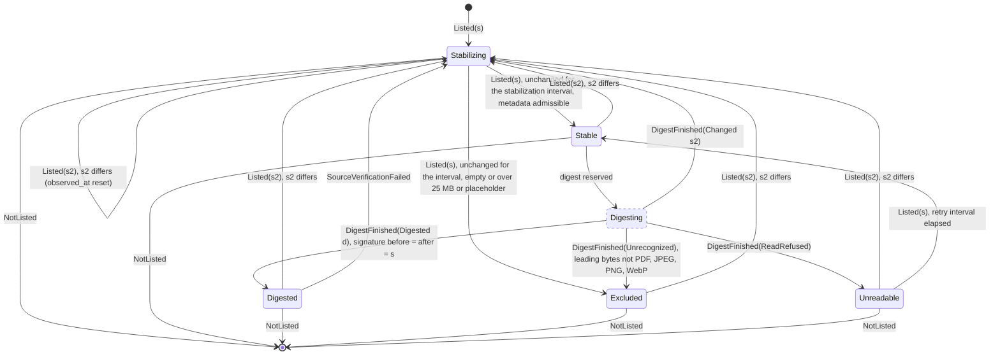
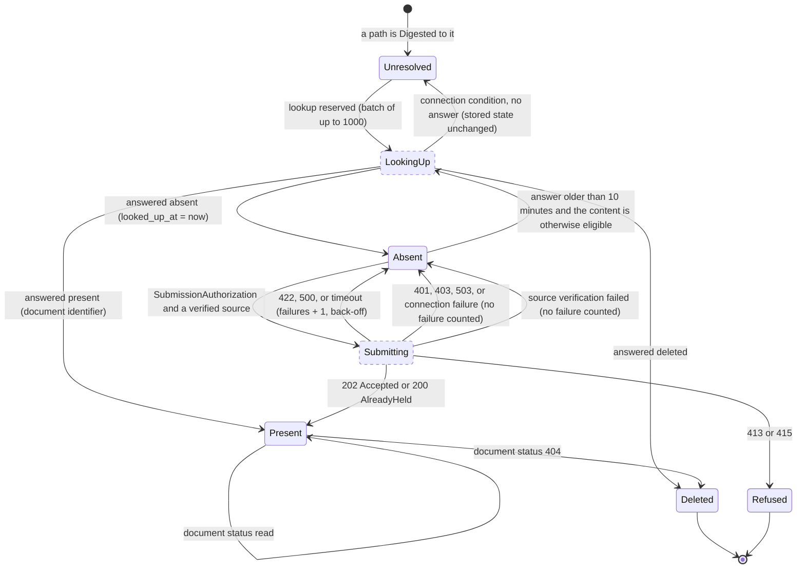
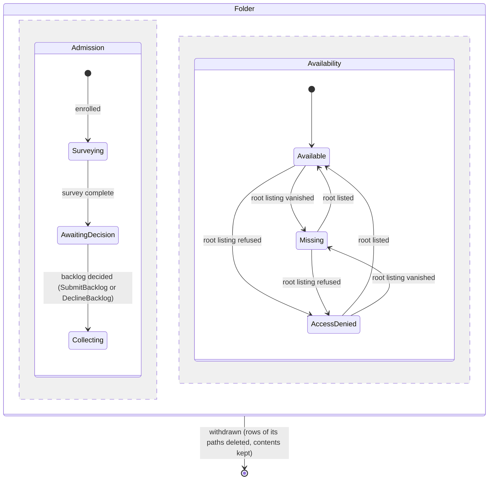
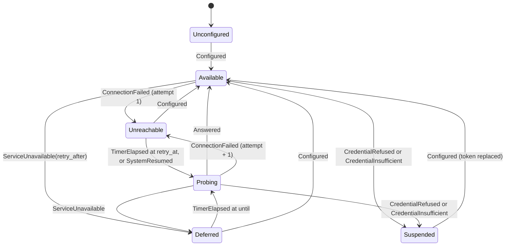

# Collector core design

The design of the desktop collector's Rust core, agreed before implementation on 2026-11-17. The base came from one of two parallel candidates. The grafts and fixes listed under [Synthesis decision](#synthesis-decision) amend it, and they take precedence where the text below says otherwise. `notes/collector_design_sketch.rs` holds the base candidate's type sketch, which the amendments update during implementation.

## Problem

Schublade's desktop collector should fill the archive from folders on a Mac in the background. Each document should get one archive entry, and the collector must never touch the user's files. The owner wants explicit state machines now, so that the implementation does not grow into a heap of edge-case patches.

The shape is not obvious because three identities move independently. A file at a path changes, moves, and disappears. A content (one exact byte sequence, named by its SHA-256) is what the archive knows about. A watched folder carries the user's consent for its backlog. A design that follows one file through its whole life ("discovered, hashed, uploaded, done") needs cross-file coordination for every duplicate, rename, and replacement. Those cross-file cases are exactly the ad-hoc branches the owner wants to avoid.

Constraints from the grounding that the design honours:

- The server API is fixed: lookup of 1 to 1000 digests, PUT by digest of at most 25,000,000 bytes, and GET of a document status (`src/collection_protocol/collection_requests.ts`).
- **The server does not refuse a PUT of a `deleted` content.** `archiveContent` in `src/ingestion/document_upload.ts` returns early only for `present`, and `claimContent` in `src/ingestion/content_identity.ts` takes over a content whose `document_id` is null. A PUT of deleted bytes therefore creates a new document. The collector alone enforces "never upload deleted", so the design makes a PUT impossible without a recent `absent` answer (see `SubmissionAuthorization`).
- FSEvents coalesces events and loses them while the app is not running. An iCloud placeholder must never be opened. A browser writes downloads under temporary names.
- The token lives in the Keychain, never in the database.
- The naming specification applies to every identifier. Code uses `content_digest`, `synchronization`, `document_identifier`, `reservation`, and never `hash`, `sync`, `id`, `ctx`, or `tx`.

## Usage (caller's view)

### The Tauri app

```rust
use collection_core::{BacklogDecision, Collector, CollectorEvent, CollectorSettings, KeychainCredentialStore};

fn setup(application: &tauri::App) -> Result<(), Box<dyn std::error::Error>> {
    let settings = CollectorSettings::new(
        application.path().app_data_dir()?.join("collector.sqlite"),
        Box::new(KeychainCredentialStore::new("Schublade collector")),
    );
    let (collector, events) = Collector::start(settings)?;
    let handle = application.handle().clone();
    std::thread::spawn(move || {
        for event in events {
            // One event name; the window invalidates its TanStack Query cache on StatusChanged
            // and shows a notification on DocumentReceived.
            let _ = handle.emit("collector-event", &event);
        }
    });
    application.manage(collector);
    Ok(())
}

#[tauri::command]
fn collector_status(collector: tauri::State<'_, Collector>) -> collection_core::CollectorStatus {
    collector.status()
}

#[tauri::command]
fn connect_archive(collector: tauri::State<'_, Collector>, address: String, token: String) -> Result<(), String> {
    let address = collection_core::ArchiveAddress::parse(&address).map_err(|refusal| refusal.to_string())?;
    collector
        .connect_archive(address, collection_core::IngestToken::new(token))
        .map_err(|refusal| refusal.to_string())
}

#[tauri::command]
fn enroll_folder(collector: tauri::State<'_, Collector>, root: std::path::PathBuf) -> Result<i64, String> {
    collector.enroll_folder(root).map(|folder| folder.value()).map_err(|refusal| refusal.to_string())
}

/// The confirmation dialog passes back the folders whose counts it showed, so a folder that
/// finished its survey while the dialog was open is never confirmed unseen.
#[tauri::command]
fn decide_backlog(collector: tauri::State<'_, Collector>, folders: Vec<i64>, upload: bool) -> Result<(), String> {
    let decision = if upload { BacklogDecision::SubmitBacklog } else { BacklogDecision::DeclineBacklog };
    let folders: Vec<_> = folders.into_iter().map(collection_core::FolderIdentifier::new).collect();
    collector.decide_backlog(&folders, decision).map_err(|refusal| refusal.to_string())
}
```

The window reads `collector_status` through TanStack Query and invalidates it on every `StatusChanged`. The confirmation dialog renders `status.backlog` ("1,240 files: 310 already in the archive, 930 new, holding 902 distinct contents"). The menu bar reads `status.attention` for the badge.

### The command-line program

```text
schublade-collector connect https://archive.example.org          # reads the token from standard input, stores it in the Keychain
schublade-collector enroll ~/Downloads ~/Desktop
schublade-collector survey                                         # waits for the counts, prints them, exits
schublade-collector decide --submit-backlog                        # confirms every folder whose survey it just printed
schublade-collector collect                                        # runs in the foreground until interrupted
schublade-collector collect --until-idle                           # runs until no work remains, then exits (CI, cron on Linux)
schublade-collector status --json
```

`--database <path>` selects the state database, and `SCHUBLADE_INGEST_TOKEN` replaces the Keychain for CI and servers without a keychain.

### A scenario test

```rust
#[test]
fn identical_file_in_three_folders_is_submitted_once() {
    let corpus = CollectionCorpus::copy_to_temporary_directory();
    let archive = SimulatedArchive::start(); // in-process HTTP server that implements the three requests
    let (collector, _events) = Collector::start(CollectorSettings::for_tests(corpus.database_path(), archive.token())).unwrap();
    collector.connect_archive(archive.address(), archive.token()).unwrap();
    let folders: Vec<_> = corpus.folder_roots().map(|root| collector.enroll_folder(root).unwrap()).collect();

    let status = collector.wait_until_idle(Duration::from_secs(30)).unwrap();
    let backlog = status.backlog.expect("every folder awaits its decision");
    assert_eq!(backlog.new_contents, 33);

    collector.decide_backlog(&folders, BacklogDecision::SubmitBacklog).unwrap();
    collector.wait_until_idle(Duration::from_secs(30)).unwrap();
    assert_eq!(archive.submission_count("b60d823ff8fc9d5e3f8979eb7be7fd57d31bcb959dcc0ec5260c4daf6ec98150"), 1);
    for ignored in corpus.expected_outcomes().ignored() {
        assert_eq!(archive.submission_count(&ignored.sha256), 0, "{} must never be submitted", ignored.path);
    }
}
```

`wait_until_idle` returns when no work can be planned and no reservation is held. The same call drives `collect --until-idle`, so the tests and the program use one mechanism.

## Shape

### Four machines, one owner

| Machine | Key | States | Persisted in | Lives in |
| --- | --- | --- | --- | --- |
| Path lifecycle | folder, directory, entry name | Stabilizing, Stable, Digested, Excluded, Unreadable | `path_observations` | `path_lifecycle.rs` |
| Content synchronization | content digest | Unresolved, Absent, Present, Deleted, Refused | `contents` | `content_synchronization.rs` |
| Folder admission | folder | Surveying, AwaitingDecision, Collecting(decision), and in parallel Available, Missing, AccessDenied | `watched_folders` (admission only) | `folder_admission.rs` |
| Archive connection | singleton | Unconfigured, Available, Unreachable, Probing, Deferred, Suspended | `archive_connection` (suspension only) | `archive_connection.rs` |

Each machine is a pure function `advance(state, event) -> state` with no I/O, no clock reads, and no knowledge of SQLite. Time enters as a field of the event. The tests in the test plan call these functions directly.

**The collection coordinator is the only writer of every piece of state** (per separate-before-serializing-shared-state). It runs on one dedicated thread, owns the one SQLite connection, and owns the in-memory reservations. Every other thread (the file-system watcher, the walker, two digest workers, one lookup worker, one or two submission workers) only performs I/O and sends its result back as a message. No worker writes the database, so no two actors ever write the same row.

| State | Writer | Durable | Readers |
| --- | --- | --- | --- |
| Folder admission | coordinator | `watched_folders.admission`, `backlog_decision`, `decided_at` | status, work planning |
| Folder availability | coordinator, from listing outcomes | no, probed again at every walk | status, work planning |
| Path state | coordinator | `path_observations` | work planning, status |
| Content standing and decline | coordinator | `contents` | work planning, status |
| Archive connection | coordinator | only `Suspended`, in `archive_connection` | work planning, status |
| Reservations (work in flight) | coordinator | never | work planning, status activities |
| Ingest token | credential store | Keychain only, the database keeps its SHA-256 fingerprint | archive client |

### Resting states are stored, work in flight is not

The central rule of persistence: **a stored state is always a resting state, and work in flight is a reservation held only in memory.** "Digesting" is a Stable path plus a digest reservation. "Looking up" and "Submitting" are an Unresolved or Absent content plus a content reservation. A crash or a quit loses only reservations, and the planner derives the same work again from the stored states. No recovery code exists beyond opening the database. This is the make-operations-idempotent principle applied to the whole core.

Every worker result carries what its work was based on (the signature it read, the content it submitted). The coordinator applies a result through the same pure transition as any other event, so a result that arrives after its path changed or disappeared falls through as `Unchanged` or `Remove`. Stale results need no special case.

### Discovery is reconciliation of directory listings

File-system events never change state directly. An event only names a directory to list again. The walker, the watcher hints, FSEvents' rescan flag, the periodic walk, the start of the app, and a wake from sleep all produce the same message: `DirectoryListing { folder, directory, outcome }`. `reconcile_directory` compares a listing with the stored rows of that directory and emits `Listed(signature)` for every entry and `NotListed` for every stored row the listing lacks. Listing a directory twice yields no transitions. A lost or coalesced event therefore costs only latency until the next listing (behaviour 18). Renames need no pairing of old and new names (behaviour 4). A case-only rename on a case-insensitive volume is handled, because existence is judged by the parent's listing and never by `stat` of a name, which would succeed for both spellings.

A listing whose directory cannot be read (`Unreadable`) never removes rows. Only a successful listing proves absence (behaviour 16).

### Content identity carries the archive's answer, paths carry the bytes

A Digested path names its content digest. The content row knows what the archive said about that digest. Duplicates (behaviour 3), renames (4), modifications (5), and replacements (6) all reduce to two independent facts. Which content does this path hold now, and what does the archive hold? A submission needs a **source**, which is any Digested path of that content in an available folder whose admission is Collecting. A content with several paths has several possible sources, and one reservation per content guarantees at most one PUT in flight per digest.

### Admission is a guard, not a state of the file

The first-scan confirmation lives on the folder, not on files or contents. Before the decision, a folder's paths are discovered, digested, and looked up, so the summary can show counts. No path of that folder is a submission source until the folder is Collecting. Files that appear while the decision is pending join the backlog and the counts update live. Files that appear after the decision flow, because their folder is already Collecting. A folder added later starts its own Surveying (behaviour 15).

The decision has two values. `SubmitBacklog` is what the owner described. `DeclineBacklog` is one more state value that costs one column. It records `declined_at` on every content of that folder that is Absent at decision time, so a user facing 930 classifications can say no without removing the folder. A declined content is never submitted, whichever path holds it later.

### Submission authorization is a type

`SubmissionAuthorization` can only be built by `authorize_submission`, from a content that is Absent, was looked up less than `lookup_validity` (10 minutes) ago, is not backing off, and is not declined. `ArchiveClient::submit` takes it by value. A PUT of a Present, Deleted, or Refused content, or one based on yesterday's answer, does not compile. After a restart every Absent answer is older than 10 minutes, so the planner looks it up again before any PUT. That re-lookup is what makes behaviour 13 hold even when the crash came after the archive stored the bytes.

`VerifiedContent` can only be built by `read_submission_source`, which reads the whole file (at most 25 MB) into memory, computes its SHA-256, and checks it against the authorized digest and the file's signature before and after the read. The bytes sent are therefore always the bytes digested (behaviour 8), and the server's 422 is a second check, not the first.

`ReadableSignature` can only be built by `classify_signature`, which refuses empty files, files over 25,000,000 bytes, and iCloud placeholders. Every function that opens a file takes a `ReadableSignature` and checks a fresh `lstat` against it before `open`. A dataless file is therefore never opened, and an oversized video is never read (behaviour 17).

### Work planning is derived, never queued

No queue is stored anywhere. After each batch of events, `plan_work` asks the store for candidates, limited by the free capacity of each lane: Stable paths for the digest lane, Unresolved or stale Absent contents for the lookup lane, authorized contents with a source for the submission lane. It then excludes reserved keys and returns the work. The SQL `LIMIT` bounds memory whatever the backlog size (behaviour 19). Work order puts arrivals first: a path first observed after its folder's decision is planned before the backlog, so an invoice downloaded today does not wait behind 5,000 old files.

| Lane | Capacity | Work |
| --- | --- | --- |
| Listing | 1 | `ListDirectory { recursive }` |
| Digest | 2 | `ComputeDigest` reads the leading bytes, then the whole file through SHA-256 in 64 KiB blocks |
| Lookup | 1 | `LookUpContents` of up to 1000 digests (67 KB of JSON, under the 128 KB limit) |
| Submission | 1 or 2, `submission_concurrency` | `SubmitContent` holds at most 25 MB per lane |
| Status | 1 | `ReadDocumentStatus` for at most 20 documents received in the last 2 hours |

The archive connection limits the three archive lanes together. Available permits all of them. Probing permits exactly one request. Unconfigured, Unreachable, Deferred, and Suspended permit none.

### Status is derived from the store

`CollectorStatus` is computed by the coordinator in one read transaction: counts per state, folders with admission, availability, and the backlog summary, current activities from the reservations, attention items, and recent receipts (`contents.received_at`, newest first). Attention items are derived from states (a Suspended connection, an unavailable folder, a folder awaiting a decision, a Refused content, a content with 3 or more failures). No list of problems is kept separately, so the badge can never disagree with the states (behaviour 20). The coordinator emits `StatusChanged { revision }` at most every 250 ms, and `DocumentReceived` once per 202.

### Interface depth

The public surface has one type with nine methods and two message enums (`CollectorEvent`, `CommandRefusal`) plus the serializable status. Hidden behind it are the four machines, listing reconciliation, settle timing, candidate rules, batching, lane limits, back-off, the connection's half-open probing, the eligibility guard, the database schema, and the HTTP protocol. No wire type, SQL row, or `notify` event crosses the surface (per boundary-discipline). `wait_until_idle` exists on the surface because both the command-line program and the tests need it, and it hides the definition of idleness (no plannable work and no reservation).

## The state machines

### Path lifecycle

Key: `(folder_identifier, directory_key, entry_name)`. A path that the name filter disregards never gets a row (hidden entries, `._` companions, `.crdownload`, `.part`, `.download` packages, other packages, symbolic links, special files).



`Digesting` is drawn dashed because it is a reservation, never a stored state. The signature is `(device, inode, byte size, modification time in nanoseconds, status change time in nanoseconds, dataless flag)`. The status change time catches a rewrite that restores size and modification time. The dataless flag means that an iCloud download in place changes the signature, so the path is examined again.

| Transition | Persists |
| --- | --- |
| first `Listed` | insert row: `lifecycle = stabilizing`, signature, `observed_at`, `first_observed_at` |
| `Listed` with a changed signature | signature, `observed_at`, `lifecycle = stabilizing`, `content_digest = NULL`, `exclusion_reason = NULL` |
| `Listed` with an unchanged signature, interval not elapsed | nothing |
| Stabilizing to Stable or Excluded | `lifecycle`, `exclusion_reason` |
| Digest reserved | nothing (memory) |
| to Digested | `lifecycle`, `content_digest`, and `INSERT OR IGNORE` of the content row as Unresolved, in the same transaction |
| to Unreadable | `lifecycle`, `unreadable_since`, `unreadable_cause` |
| `NotListed` | delete the row; the content row stays; the sighting record gains `withdrawn_at` |

### Content synchronization

Key: the content digest. A row exists once any path has been Digested to it. Rows are never deleted. A Present or Deleted row is a cache that saves a lookup when the bytes reappear. An Absent row without paths does nothing, because work requires a source.



`LookingUp` and `Submitting` return to the stored state they started from when no answer arrives, which is why the diagram shows `LookingUp --> Unresolved` (the stored row was Unresolved all along). Present, Deleted, and Refused are never looked up again and never submitted. Present can only become Deleted, through a 404 while following a recent document.

| Transition | Persists |
| --- | --- |
| row created | `archive_standing = unresolved` |
| answered absent | `archive_standing = absent`, `looked_up_at`; `submission_failures` keeps its value |
| answered present | `archive_standing = present`, `document_identifier` |
| answered deleted, or status 404 | `archive_standing = deleted`, `document_identifier = NULL` |
| 202 or 200 | `present`, `document_identifier`, `document_status`, `failure_reason`, `received_at` (only on 202), `status_read_at` |
| 413 or 415 | `archive_standing = refused`, `refusal_reason` |
| 422, 500, timeout | `submission_failures + 1`, `retry_not_before` |
| backlog declined | `declined_at` |
| reservations, connection conditions, source failures | nothing |

The consequences of each answer of the archive come from one table, `archive_connection::consequences`, so no caller decides on its own whether a 500 belongs to the content or to the connection:

| Answer | Connection event | Content event |
| --- | --- | --- |
| lookup 200 | `Answered` | `LookupAnswered` per digest |
| PUT 202, 200 | `Answered` | `SubmissionAnswered(Accepted or AlreadyHeld)` |
| PUT 413, 415 | `Answered` | `SubmissionAnswered(TooLarge or UnacceptedKind)` |
| PUT 422 | `Answered` | `SubmissionFailed(DigestDisagreement)` |
| PUT 500 | `Answered` | `SubmissionFailed(ServerError)` |
| lookup 500, 400, unparseable body | `ConnectionFailed` | none |
| 401 | `CredentialRefused` | none |
| 403 | `CredentialInsufficient` | none |
| 503 with `Retry-After` | `ServiceUnavailable(retry_after)`, 900 s when absent or unreadable | none |
| connection failure | `ConnectionFailed` | none |
| PUT timeout | `ConnectionFailed` | `SubmissionFailed(TimedOut)` |

A PUT 500 counts against the content because one malformed file must not stop the whole collector. A PUT timeout counts against both, so a 25 MB file over a slow line backs off instead of starving the lane.

Content back-off after a failure: 1 minute, 5 minutes, 30 minutes, 2 hours, 6 hours, then 24 hours. The status lists a content with 3 or more failures as needing attention, and retries continue.

### Folder admission and availability



The survey is complete when the folder's initial walk has finished in this process, no path of the folder is Stabilizing or Stable, and every content of its Digested paths is resolved (not Unresolved). Unreadable and Excluded paths do not hold the survey back. The coordinator evaluates this predicate after every batch, so the transition needs no event source. The first transition needs the archive. While the connection is Deferred (the archive still records old digests) or Unreachable, the folder stays Surveying, and the status says why.

`decide_backlog` is accepted only for folders in AwaitingDecision and only for the folders the caller names. A folder still Surveying answers `CommandRefusal::SurveyIncomplete`.

`enroll_folder` refuses a root inside an enrolled folder or containing one (`FolderOverlapsEnrolledFolder`). With nested roots, one file would have two rows under two admissions, and the counts would include it twice.

| Transition | Persists |
| --- | --- |
| enrolled | insert `watched_folders` row, `admission = surveying`, `enrolled_at` |
| survey complete | `admission = awaiting_decision` |
| backlog decided | `admission = collecting`, `backlog_decision`, `decided_at`; with DeclineBacklog, `declined_at` on every Absent content of its paths, in the same transaction |
| availability changes | nothing; the walk on start probes again |
| withdrawn | delete the folder row; `ON DELETE CASCADE` removes its paths |

### Archive connection



`Probing` is a half-open state. It permits exactly one archive request, and its answer decides the next state. Answers that arrive in Suspended (an upload that was already in flight) still update their content, but they never leave Suspended. Only a new token leaves it (behaviour 11). The probe back-off is 15 seconds, 30 seconds, 1, 2, 5, then 15 minutes. `SystemResumed` comes from the app (macOS `NSWorkspaceDidWakeNotification`) or from the coordinator itself when the wall clock jumps more than a minute past its last tick.

Only Suspended is persisted, with the fingerprint of the token it refused, so a restart with the same token still shows the problem and sends nothing. `connect_archive` with a different token clears it. Unreachable and Deferred are not persisted, and a restart probes once.

## The 20 behaviours

| # | Behaviour | States and transitions |
| --- | --- | --- |
| 1 | File still being written | Path Stabilizing until two listings at least 5 seconds apart show the same signature. Every change of size, modification time, or status change time resets `observed_at`. The coordinator plans a listing of the directory when the oldest Stabilizing row there becomes due, so the second observation always happens. No shortcut on old modification times, because Finder keeps the modification time of a copy in progress. |
| 2 | Browser download in progress | The name filter disregards `.crdownload` and `.part` files and every `.download` package, so no row exists. The rename to the final name makes a new entry in the parent listing, which starts Stabilizing. |
| 3 | Same bytes at several paths | Each path is Digested to the same content. One content row, one reservation per content, one PUT. The other paths are further sources. |
| 4 | Rename or move inside watched folders | The old name is NotListed (row deleted). The new name goes Stabilizing, Stable, Digested to the known content. The content is Present (or Absent and its single PUT is unaffected), so nothing is sent again. The cost is one more digest. |
| 5 | Modified after submission | The changed signature sends the path to Stabilizing, then Digested to a new content, which is Unresolved, looked up, and submitted. The old content row stays Present. |
| 6 | Atomic replace by rename | The target name keeps its row and its signature changes (new inode), which is case 5. A temporary file either matches the name filter or vanishes before it stabilizes. |
| 7 | Deleted locally | Before digest or submission, the row is deleted and nothing reaches the archive. During digest, the read fails or the signature differs, and the next listing removes the row. During submission, `read_submission_source` either fails (source failure, the content stays Absent) or already holds verified bytes, which complete the PUT. After submission, the content stays Present. The core has no request that deletes, so the archive is never told. |
| 8 | Changed while digesting or submitting | `DigestFinished` carries the signatures before and after the read. Any difference, or a stored signature that changed meanwhile, means Stabilizing. Submission reads the whole file into memory and checks digest and signatures before the PUT. A failure sends that path to Stabilizing and leaves the content Absent with no failure counted. |
| 9 | Lookup answers | `LookupAnswered` moves Unresolved or Absent to Absent, Present, or Deleted. Deleted is terminal and `authorize_submission` refuses every state but Absent. |
| 10 | PUT answers | The consequences table above. 202 and 200 lead to Present, 413 and 415 to Refused, 422, 500, and timeout to Absent with back-off, 401 and 403 to Suspended, 503 to Deferred, network failure to Unreachable. |
| 11 | Token revoked or wrong | Connection Suspended, persisted. No archive lane runs. Path and content states keep advancing locally (listing and digesting continue), so nothing is lost and the queue is ready when the user pastes a new token. |
| 12 | Archive unreachable for hours, sleep and wake | Unreachable with back-off up to 15 minutes, Probing with one request. Wake sends `SystemResumed`, which probes at once and starts a full walk of every folder. |
| 13 | Quit or crash mid-digest or mid-upload | Only resting states are stored. On start, Stable paths are digested again. Absent contents are older than the 10-minute lookup validity, so they are looked up again before any PUT. If the archive stored the bytes before the crash, the lookup answers present. A PUT of held bytes would answer 200 as a second safety. |
| 14 | State database lost | The database holds the configuration too, so its loss returns the app to setup as a whole. The token is still in the Keychain under the archive address. The new survey digests everything, and the lookup answers present for every content the archive holds, so the counts show them as already archived and nothing is sent twice. Declined decisions are lost and asked again. A corrupt database is renamed aside, never deleted. |
| 15 | First-scan confirmation | Folder admission. Surveying, then AwaitingDecision with live counts, then Collecting. Sources must lie in a Collecting folder. A later folder gets its own Surveying. Files arriving during AwaitingDecision join the backlog. |
| 16 | Folder removed, missing, unmounted, unreadable | Withdrawal deletes the folder and its path rows; contents stay. Missing or AccessDenied is the availability region. Its paths keep their rows and are not sources. A failed listing never removes rows. |
| 17 | Not candidates | Name filter, no row: hidden entries, `._` companions, incomplete downloads, packages, symbolic links (not followed: following them can leave the watched folders, loop, and count one file twice; a target inside a watched folder is collected there), special files. Signature exclusion, a row in Excluded: empty, over 25,000,000 bytes, iCloud placeholder (until the flag clears and the signature changes). Leading-bytes exclusion, Excluded after the digest lane reads 12 bytes: unrecognized content. |
| 18 | Lost or coalesced events, rescan flag, periodic walk | Events only name directories. A rescan flag lists the subtree recursively. A full walk runs at start, every 30 minutes, after wake, and when a folder becomes available again. Reconciliation is idempotent. |
| 19 | 5,000 files at once | Candidates come from SQL with `LIMIT` per lane. Lookups batch up to 1000. One or two submissions. Memory stays near 50 MB for submission buffers plus small constant overhead. Arrivals after the decision go first, then the backlog in discovery order. Counts are per content and per file, so progress is the falling count of contents awaiting submission. |
| 20 | Live, consistent view | `status()` is one read transaction in the coordinator. Attention items are derived. `StatusChanged` is coalesced to at most every 250 ms, and `DocumentReceived` announces each new document with its link. |

## Persistence

One SQLite file (`rusqlite` with the bundled SQLite, WAL journal, `foreign_keys = ON`). The schema version lives in `PRAGMA user_version`, and migrations are embedded SQL run in order at open. Timestamps are Unix milliseconds.

```sql
CREATE TABLE archive_connection (
    singleton INTEGER PRIMARY KEY CHECK (singleton = 1),
    archive_origin TEXT NOT NULL,
    credential_fingerprint TEXT NOT NULL,
    suspension_reason TEXT CHECK (suspension_reason IN ('credential_refused', 'credential_insufficient')),
    suspended_at INTEGER,
    CHECK ((suspension_reason IS NULL) = (suspended_at IS NULL))
);

CREATE TABLE watched_folders (
    folder_identifier INTEGER PRIMARY KEY,
    root_path BLOB NOT NULL UNIQUE,
    enrolled_at INTEGER NOT NULL,
    admission TEXT NOT NULL CHECK (admission IN ('surveying', 'awaiting_decision', 'collecting')),
    backlog_decision TEXT CHECK (backlog_decision IN ('submit_backlog', 'decline_backlog')),
    decided_at INTEGER,
    CHECK ((admission = 'collecting') = (backlog_decision IS NOT NULL)),
    CHECK ((backlog_decision IS NULL) = (decided_at IS NULL))
);

CREATE TABLE contents (
    content_digest TEXT PRIMARY KEY CHECK (length(content_digest) = 64),
    archive_standing TEXT NOT NULL CHECK (archive_standing IN ('unresolved', 'absent', 'present', 'deleted', 'refused')),
    looked_up_at INTEGER,
    submission_failures INTEGER NOT NULL DEFAULT 0,
    retry_not_before INTEGER,
    document_identifier TEXT,
    document_status TEXT,
    failure_reason TEXT,
    status_read_at INTEGER,
    received_at INTEGER,
    refusal_reason TEXT CHECK (refusal_reason IN ('too_large', 'unaccepted_kind')),
    declined_at INTEGER,
    CHECK ((archive_standing = 'present') = (document_identifier IS NOT NULL)),
    CHECK ((archive_standing = 'refused') = (refusal_reason IS NOT NULL)),
    CHECK (archive_standing <> 'absent' OR looked_up_at IS NOT NULL)
);

CREATE TABLE path_observations (
    folder_identifier INTEGER NOT NULL REFERENCES watched_folders ON DELETE CASCADE,
    directory_key TEXT NOT NULL,
    entry_name BLOB NOT NULL,
    device INTEGER NOT NULL,
    inode INTEGER NOT NULL,
    byte_size INTEGER NOT NULL,
    modification_nanoseconds INTEGER NOT NULL,
    status_change_nanoseconds INTEGER NOT NULL,
    dataless INTEGER NOT NULL CHECK (dataless IN (0, 1)),
    lifecycle TEXT NOT NULL CHECK (lifecycle IN ('stabilizing', 'stable', 'digested', 'excluded', 'unreadable')),
    observed_at INTEGER NOT NULL,
    first_observed_at INTEGER NOT NULL,
    content_digest TEXT REFERENCES contents,
    exclusion_reason TEXT CHECK (exclusion_reason IN ('empty_file', 'exceeds_size_limit', 'cloud_placeholder', 'unrecognized_content')),
    unreadable_cause TEXT,
    PRIMARY KEY (folder_identifier, directory_key, entry_name),
    CHECK ((lifecycle = 'digested') = (content_digest IS NOT NULL)),
    CHECK ((lifecycle = 'excluded') = (exclusion_reason IS NOT NULL)),
    CHECK ((lifecycle = 'unreadable') = (unreadable_cause IS NOT NULL))
) WITHOUT ROWID;

CREATE INDEX path_observations_content_index ON path_observations (content_digest) WHERE content_digest IS NOT NULL;
CREATE INDEX path_observations_lifecycle_index ON path_observations (lifecycle, first_observed_at);
CREATE INDEX contents_standing_index ON contents (archive_standing, retry_not_before);
CREATE INDEX contents_received_index ON contents (received_at) WHERE received_at IS NOT NULL;
```

The `CHECK` constraints repeat the variants of the Rust enums, so a row that no state can produce fails at write time. `directory_key` is the relative directory in Unicode normalization form C, so a watcher path in decomposed form matches the walker's rows. `entry_name` is the exact byte name from `readdir`, which the open call uses. Two names that differ only in normalization on a Linux file system share a directory key only when they are directories, a case the design accepts.

Further per-content hints (the text-layer fingerprint) need no reshaping. They become a table `content_hints (content_digest, hint_kind, algorithm_version, hint_value)` and a lane whose candidates are Digested paths of contents without that hint. The content machine does not change, because a hint is not a step toward the archive. The table is not created now.

Recovery on start: open the database (a file that fails `PRAGMA quick_check` is renamed to `collector.sqlite.unreadable-<time>`, and the app returns to setup), read the folders and the connection suspension, start with empty reservations, list every folder recursively, and plan. Nothing else.

## Module map

```text
collector/
    Cargo.toml                          workspace: collection_core, collection_command; collection_application joins later
    collection_core/src/
        lib.rs                          Collector, CollectorSettings, CollectorEvent, CommandRefusal; re-exports of the status types
        domain_types.rs                 ContentDigest, FileSignature, FolderIdentifier, DirectoryKey, EntryName, PathKey, Timestamp, DocumentIdentifier, DocumentStatus
        candidate_classification.rs     the name filter, ReadableSignature, ContentKind and its leading-byte signatures, the size limit
        path_lifecycle.rs               PathState, PathEvent, advance_path
        content_synchronization.rs      ArchiveStanding, ContentEvent, advance_content, SubmissionAuthorization, authorize_submission
        folder_admission.rs             FolderAdmission, FolderAvailability, BacklogDecision, decide, survey_complete
        archive_connection.rs           ConnectionState, ConnectionEvent, advance_connection, request_capacity, consequences
        directory_reconciliation.rs     DirectoryListing, reconcile_directory
        work_planning.rs                Work, Reservations, WorkCandidates, plan_work
        state_store.rs                  schema, migrations, rows to and from states, candidate and status queries; the only file with SQL
        file_system_observation.rs      notify watcher to directory hints, recursive walker, lstat signatures with st_flags, digest and source reads
        archive_client.rs               ureq requests, problem details, Retry-After; returns domain outcomes only
        credential_storage.rs           CredentialStore, KeychainCredentialStore, FixedCredentialStore
        status_report.rs                CollectorStatus, BacklogSummary, AttentionItem, Receipt
        collection_coordinator.rs       the owner thread: inbox, batches, transactions, reservations, timers, lane dispatch, events
    collection_core/tests/
        collection_scenarios.rs         corpus scenarios against SimulatedArchive
        simulated_archive.rs            in-process HTTP server with the three requests, the 503 phase, and fault injection
    collection_command/src/main.rs      schublade-collector: connect, enroll, survey, decide, collect, status
```

Tracing one transition takes three files: `collection_coordinator.rs` receives the result, the machine's file decides, and `state_store.rs` writes. The pure files (`candidate_classification`, `path_lifecycle`, `content_synchronization`, `folder_admission`, `archive_connection`, `directory_reconciliation`, `work_planning`) import nothing with I/O, and a unit test of each needs no file system, clock, or network.

Crates. `notify` 8.2.2 for FSEvents, inotify, and ReadDirectoryChangesW, verified on Linux. `rusqlite` with `bundled`, so every system has the same SQLite. `ureq` 3 with rustls for HTTP. The core makes at most four concurrent requests from worker threads, and a blocking client keeps it free of an async runtime; `reqwest`'s blocking client would start a Tokio runtime inside the core anyway. `sha2` for the digest. `keyring` 3 with `apple-native` for the Keychain. `unicode-normalization` for directory keys. `url` to parse the pasted archive address down to its origin. `serde` and `serde_json` for the wire and for the status the app serializes. Standard library channels with `recv_timeout` carry the coordinator's inbox and timers. Development: `tempfile` and `tiny_http` for the simulated archive.

## Synthesis decision

Two runners on different models designed the core independently from the same brief, and a judge from a third run scored both against six criteria. This candidate became the base. The judge preferred it on five of the six criteria and tied it on testability. Both candidates converged on the essentials: paths and contents as separate machines keyed differently, one owner of all state, derived readiness, and the whole file read into memory before a submission. That agreement is the strongest signal the shape is right.

Why this base. It stores only resting states, so no recovery code exists. File-system events only name directories to list again, so a lost or coalesced event costs latency, never correctness. A submission needs a `SubmissionAuthorization` built from an `absent` answer less than 10 minutes old, so a stale answer cannot revive a document the owner deleted. The other candidate had no staleness bound. One table maps every archive answer to its connection and content events.

Grafts from the other candidate:

1. **Sighting history.** This base deletes a path row on `NotListed`, which would lose the provenance that a later sightings endpoint needs. A table `content_sightings (content_digest, folder_identifier, relative_path, first_seen_at, last_seen_at, withdrawn_at)` gains a row in the same transaction as a path's transition to Digested, and `NotListed` sets `withdrawn_at`. It is a record, not a machine, and nothing reads it for decisions.
2. **An archive seam without a port or real time.** `ArchiveClient` is a trait. Scenario tests use an in-process fake with scripted answers and failures, together with a `Clock` the test advances, so a scenario runs in milliseconds. The HTTP `SimulatedArchive` stays for a few tests of the real client.
3. **Exclusion counts per reason.** The backlog summary reports disregarded and excluded files per reason (incomplete download, hidden, package, empty, oversized, placeholder, unrecognized content). Name-filtered entries have no row, so the latest full walk of each folder counts them in memory.

Fixes the judge found:

1. **The root listing goes to availability only.** A listing of a folder's root that answers missing or refused moves the availability region, and never reaches `reconcile_directory`. Otherwise an unmounted volume would delete its rows.
2. **The CHECK lists and the Rust enums stay equal.** A unit test reads the schema's CHECK constraints and fails when a list differs from the variants of its enum.
3. **`Reservations.occupied` goes.** A lane's occupancy is the size of its reservation set.

Rejected from the other candidate: in-flight states in the database with a recovery pass, effects pushed from transitions next to a pulling scheduler (two ways to schedule), the walk generation sweep (it marked a file created during the walk as absent), and oldest-first work order (today's invoice would wait behind the backlog).

Decisions the owner made on 2026-11-17:

- **No decline.** The first build offers one decision per folder backlog: upload everything. The confirmation dialog shows the counts with the buttons "Upload N files" and "Remove folder". `BacklogDecision` and `DeclineBacklog` stay out, and `declined_at` is not created.
- **The archive refuses a PUT of a deleted content.** `PUT /api/v1/contents/{sha256}` answers 409 for a content whose document the owner deleted, so no collector can bring it back. Only a person's browser upload revives it. The collector maps 409 to Deleted.
- **The dialog says that new files need no confirmation.** The confirmation is asked once per folder, for the files found when the folder is added. The dialog must say both halves: what happens to the files already there (the counts, with skipped files per reason), and that from now on every new PDF or image in that folder is uploaded automatically without asking again. The main button reads like "Upload 930 files and keep collecting". A folder that is Collecting never asks again.
- **The defaults stay.** A 5-second stabilization interval, symbolic links not followed, and one leading-byte rule that a test compares with `src/ingestion/source_file.ts`.

## Tradeoffs accepted

- We accept a second digest of a renamed or moved file in exchange for no rename pairing logic. An inode-and-signature shortcut can come later as a pure optimization inside `advance_path`, because it would change no state's meaning.
- We accept a listing of a whole directory per event (5,000 `lstat` calls for a busy Downloads folder, a few milliseconds) in exchange for one reconciliation path that cannot lose events.
- We accept holding up to 25 MB per submission lane in memory in exchange for the local guarantee that the bytes sent are the bytes digested.
- We accept a lookup before every submission after a pause of 10 minutes in exchange for never submitting on a stale answer. This also narrows the server gap where a PUT revives a deleted content.
- We accept that a declined content stays declined at any new path, including a fresh download of the same bytes, in exchange for one column and one clear rule: "Decline keeps these documents out."
- We accept losing the folder list with the database in exchange for never collecting a backlog that no one confirmed.
- We accept 5 seconds of latency for every new file in exchange for never digesting a file in progress, including a Finder copy whose modification time is old.
- We accept no FSEvents replay by event identifier. The walk at start finds what changed while the app was closed, at the cost of reading directory metadata once per start.
- We accept rows for excluded files (a `.docx` in Downloads) in exchange for reading their leading bytes only once per signature.

## Alternatives considered

- **One machine per file, path-centric** (Discovered, Settled, Hashed, LookedUp, Uploading, Done). Its interface looks simpler, but behaviours 3 to 6 become cross-row questions ("is another path of this digest already uploading?", "did this file's old content get uploaded?"). Each would be a special branch. Separating paths from contents hides those questions in the data model.
- **Apply watcher events directly** (create inserts a row, remove deletes it, rename moves it). It needs rename pairing, coalescing rules, and FSEvents' rescan flag as special cases, and its correctness depends on never missing an event. Listing reconciliation makes every event a hint and its loss harmless.
- **An append-only journal with state as a fold of it.** It gives an audit trail but makes the local database a second source of truth beside the archive, needs compaction, and replays on every start. The archive is the authority for contents. The local database is a cache of resting states.
- **Persist in-flight states** (`hashing`, `uploading`) with recovery rules for each. Every such state needs a "what if we crash here" rule. Reservations in memory have one rule: they vanish.
- **Async Tokio actors with every row in memory.** Memory grows with the backlog, `rusqlite` is synchronous, and the core never runs more than six concurrent operations. A synchronous owner thread with worker threads is smaller and deterministic in tests.
- **Stream each upload from disk and rely on the server's 422.** The bytes could change mid-stream and the guarantee would live only on the server. A 25 MB buffer per lane is cheap.
- **The folder list in a separate configuration file.** If the database were lost and the configuration kept, every folder would be Collecting with no rows, and the whole backlog would be submitted without a confirmation.
- **Confirmation per file or per content.** That needs an "unconfirmed" attribute on every row, and a new folder's backlog cannot be told from arrivals without one. A guard on the folder carries the same meaning in one column.

## Implementation reconciliation

The first part of the implementation (the server's 409, the workspace, the pure machines, the store, the planner, and the archive seam, committed 2026-11-17) departs from the sketch in these places. Each is the smallest version that compiled and tested; none changes a state's meaning.

1. **The server refuses a deleted content before it reads the body.** `serveContentSubmission` looks the path's digest up first and answers 409 without reading the PUT body, so a collector pays no upload for the refusal. The residual gap is the moment between that lookup and `archiveContent`'s claim, which the 10-minute lookup validity already bounds.
2. **`FileSignature` nanoseconds are `i64`**, not `i128`, because SQLite stores 64-bit integers and Unix nanoseconds fit until 2262.
3. **`DocumentStatus` has `AwaitingRendering`**, the server's first status, so every status answer parses.
4. **`reconcile_directory` takes stored child directories as `DirectoryKey`s**, not names. The store derives them from normalized keys, and a listed name normalizes to the same key, so a decomposed name from FSEvents matches.
5. **`reconcile_directory` leaves a vanished or unreadable root untouched itself.** Fix 1 holds as a property of the function, whatever the coordinator routes to it.
6. **`PathEvent::SourceVerificationFailed` carries `based_on`**, so a stale source failure falls through as `Unchanged` like a stale digest result. A vanished file (`current: None`) in either event is `Unchanged`; only the next listing removes the row, so the coordinator should list the directory after such a result.
7. **422 is `ArchiveCondition::DigestDisagreement`**, not a `SubmissionOutcome`, and the consequences table turns it into `SubmissionFailed(DigestDisagreement)` as the table above says. `SubmissionOutcome::Deleted` is the 409.
8. **`consequences` takes an `ArchiveAnswer`**, the whole result of one request with the content it was about, successes included, and returns `Consequences { connection, contents }`. One table covers every answer.
9. **`ConnectionState::Probing` carries `since`**, so a failed probe keeps the time the archive became unreachable; the retry time is the failure time plus the back-off. A credential answer or a 503 moves the connection from any state but Unconfigured and Suspended, because it is a fact about the archive whatever request brought it.
10. **Schema.** `watched_folders` has no `backlog_decision` and `contents` no `declined_at` (the owner's decision). `path_observations` gains `unreadable_since`. `content_sightings` holds `relative_path` as the normalized key text of the path, and a row that leaves Digested withdraws its sighting as `NotListed` does, because the content is no longer at that path.
11. **`Reservations` holds `ContentReservation::LookingUp(LookupBatch)`**, and a lane's occupancy is derived from the sets, with one lookup batch counted once. The coordinator numbers the batches.
12. **Store API.** `work_candidates` takes the available folders, because a listing below a missing root would read as vanished and a missing folder admits no source. `remove_subtrees` replaces `apply_reconciliation_removals`. `directory_contents` returns `DirectoryContents`. `apply_path` takes the event time. `store_standing` always writes. Stale absent contents come from the store's lookup query, limited to 1000 per batch, so a restart refreshes thousands of stale answers in a few lookups instead of two per planning round.
13. **`ArchiveClient` is a trait** (graft 2) with `HttpArchiveClient` and `ScriptedArchive`. `ArchiveAddress::parse` returns `ArchiveAddressRefusal` until `CommandRefusal` arrives with the coordinator. `VerifiedContent::from_bytes` computes the digest from the bytes it holds; the signature checks before and after the read belong to `read_submission_source`.
14. **`Clock` lives in `clock.rs`** with `SystemClock` and `ManualClock`. `status_report.rs` holds only `BacklogSummary` (with `files_refused_by_archive`), `StateCounts`, and `Receipt`, which gets its link from the coordinator, the only holder of the origin.

The second part (the file system observation, the coordinator, the credential stores, the corpus scenarios, and the program, committed 2026-11-17) departs in these further places.

15. **A listing counts what it disregards.** `ListingOutcome::Listed` carries `disregarded: BTreeMap<DisregardReason, u64>` (graft 3). The coordinator keeps the counts of the latest listing of each directory and sums them into `BacklogSummary.disregarded_files`; `excluded_files_by_reason` comes from the rows. The `.download` package counts as one disregarded entry, not as the files inside it.
16. **Idle means nothing now, not nothing ever.** `wait_until_idle` returns once no work can be planned at the present time and no reservation is held. A Stabilizing path, a back-off, a probe, a hint that still coalesces, or the next full walk is reported as `CollectorStatus.next_scheduled_at`. A scenario moves its manual clock there and waits again; `survey` and `collect --until-idle` sleep until a deadline within a minute and end at a later one. The sketch's idleness ("no pending hint, no deadline earlier than now") would have blocked a manual-clock scenario forever at the first stabilization.
17. **The watcher ignores `Access` events and hints the parent.** inotify reports the digest lane's own reads; a hint names the directory that holds the event path (the root for an event on the root itself), and the rescan flag becomes a recursive listing of every folder. A listing that is part of a reserved recursive walk schedules no listing for its unexplored subdirectories, because the walk reaches them itself.
18. **A subdirectory that vanished with its root reports the root.** The listing lane, on a `Vanished` outcome below the root, checks the root and reports the root listing instead when it is gone too, so an unmount between planning and listing reaches the availability region and removes nothing. The coordinator also reconciles no listing of an unavailable folder but its root.
19. **The survey concludes only while the folder is Available** and its recursive walk completed in this process. A folder whose root is missing stays Surveying with its counts rather than concluding on zero rows.
20. **`decide_backlog` takes only the folders.** With one decision there is no `BacklogDecision` parameter. `enroll_folder` refuses a root that is not a directory (`CommandRefusal::FolderRootNotADirectory`), so a mistyped path is never enrolled as a Missing folder.
21. **`connect_archive` with the same token keeps a suspension.** The store clears the suspension only for a different fingerprint, so the coordinator reads the record back after storing and stays Suspended for a repeated token.
22. **The coordinator notices a clock jump.** A wake more than a minute later than the expected one counts as `SystemResumed`, as the design says, measured against the time the loop began waiting plus the real time it waited. A manual clock moved by hours therefore also walks every folder and probes, which the scenarios tolerate because both are idempotent.
23. **`Receipt.document_link` comes from the store**, which holds the archive origin in `archive_connection`, not from the coordinator. `Activity::FollowingDocument` carries no identifier.
24. **The credential stores.** `FixedCredentialStore` holds one token, from a value or from `SCHUBLADE_INGEST_TOKEN` (`from_environment`), and stands for both the fixed and the environment store of the sketch. `KeychainCredentialStore` compiles only on macOS (`keyring` 3.6.3 with `apple-native`). `IngestToken::secret` exists for the stores and the request header. The database holds the fingerprint only.
25. **`CollectorSettings` carries an `ArchiveClientConstructor`** from address and token to `Arc<dyn ArchiveClient>`, the HTTP client in `CollectorSettings::new` and the scripted archive in `with_fixed_archive`; the clock is an `Arc<dyn Clock>` shared with the lanes. `ScriptedArchive` gains `answer_next_lookup` for the window between a lookup and a PUT, and `holds`.
26. **Two submission lanes let one PUT through.** A 401 or 503 answers one request; the PUT in flight on the other lane completes and its content becomes Present, as the design allows for an upload already in flight. The refused PUT counts no failure, so that content is submitted again when the connection returns.
27. **The watcher matches events against the root as given and as canonicalized.** FSEvents reports real paths, so a root enrolled as `/var/folders/...` (the Mac's temporary directory, a link to `/private/var/...`) or through any symbolic link produced no hints until the canonical spelling was matched too; inotify reports the watched spelling. Found by the corpus scenario that writes a file after the decision, which passed on Linux and made no progress on the Mac.
28. **Dependencies build with `opt-level = 2` in the dev profile**, because unoptimized SHA-256 and SQLite made a corpus scenario take six seconds of CPU; the ten scenarios now run in 5 to 18 seconds together on an 8-core Linux machine, most of it the parallel digests of ten corpus copies.

The third part (the Tauri app, `collection_application` with its window `collection_interface`, committed 2026-11-17) added three small things to the core. The app holds no collection logic of its own.

29. **Each folder carries its own backlog.** `FolderStatus.backlog` holds the folder's `BacklogSummary` while it is AwaitingDecision and is None otherwise. The confirmation is asked once per folder, and `CollectorStatus.backlog` sums every waiting folder, so a second folder that finished its survey would have changed the counts of the first folder's dialog. `CollectorStatus.backlog` stays for the command-line program.
30. **`HttpArchiveClient::verify_credential`** tries an address and token before they are stored. It sends one lookup of the all-zero digest, which no file has. The setup screen can then say "the token was refused" or "the archive could not be reached" at once. Without it, `connect_archive` stores any token, and a wrong one shows only as a suspension after the first folder's survey. The check runs on the app's command thread, not in the coordinator, so a slow network never holds a batch.
31. **`CommandRefusal` serializes.** The window receives the variant with its folder identifier and words it with the folder's name. The identifier in the `Display` text means nothing to a person.

## Open questions and risks

1. Should the archive refuse a PUT of a `deleted` content (for example 409 with a problem document)? Today it revives the document, and the collector's 10-minute validity only narrows the window in which another device could have uploaded and the owner could have deleted the content. A server change closes it for every collector, the iPhone app included.
2. Do you want `DeclineBacklog` in the first release, or only "Start upload"? It costs one column and one enum value, and it is the only way to keep an old backlog out without removing the folder.
3. Is 5 seconds the right stabilization interval? A slow network share can pause a copy longer. The interval is one field of `TimingPolicy`.
4. Should symbolic links stay unfollowed? The design does not follow them. A user who links a folder from another volume into Downloads would have to enroll that folder.
5. The leading-byte signatures exist twice, in `src/ingestion/source_file.ts` and in `candidate_classification.rs`. Should the Rust test read the TypeScript file, or should the signatures move into a shared JSON file that both read?
6. Package detection uses a list of extensions (`.app`, `.bundle`, `.download`, `.pages`, `.numbers`, `.key`, `.photoslibrary`, and others). Should the macOS build ask `NSWorkspace` instead?
7. Should the window show excluded files with their reason, or only their count?
8. Document status following polls at most 20 documents for 2 hours after their receipt. Is that enough for the "recent uploads" list?

## Next implementation step

Write `domain_types.rs`, `candidate_classification.rs`, and `path_lifecycle.rs` with table tests over `advance_path`, then `directory_reconciliation.rs`, because every later machine consumes the paths they produce.
